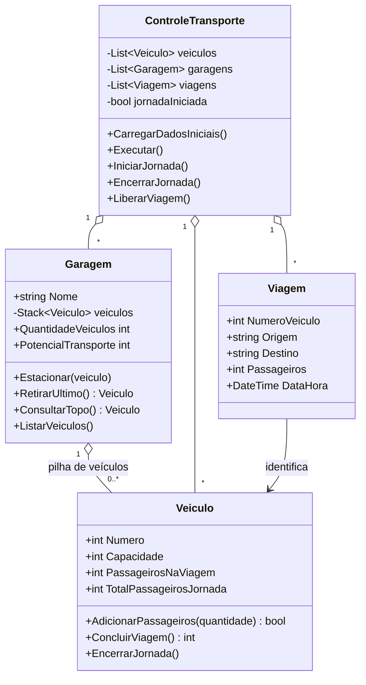

## Como executar
No terminal, dentro da pasta do projeto:

```bash
dotnet restore
dotnet run
```

## Dados iniciais
O programa inicia com:
- 8 veículos numerados de 1 a 8;
- garagem Congonhas;
- garagem Guarulhos;
- capacidade inicial de 15 passageiros por van.


## Regras implementadas
- Cada garagem possui uma pilha de veículos (`Stack<Veiculo>`).
- O último veículo estacionado é o primeiro a sair (LIFO).
- A jornada precisa ser iniciada antes de liberar viagens.
- No início da jornada, os veículos são distribuídos alternadamente entre as garagens.
- Cadastros de veículos e garagens só são permitidos com a jornada encerrada.
- A opção de liberar viagem registra passageiros na van do topo da pilha. A viagem só é realizada quando a lotação fica completa.
- Ao viajar, o veículo sai da pilha de origem e entra no topo da pilha de destino.
- Ao encerrar a jornada, é exibido o total transportado por veículo e os registros da jornada são limpos.

## Diagrama de classes

